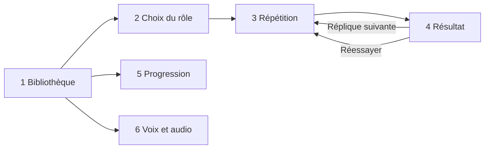

# Wireframes

Basse fidélité, textes en français. Les six écrans ci-dessous sont dessinés en version bureau (Linux, navigateur large) ; la section « Android et web » donne leur adaptation aux petits écrans. Les extraits viennent de *Tartuffe* de Molière (domaine public). Ce document est la référence du dépôt : les maquettes interactives (canevas Design) servent à les discuter, pas à les remplacer.

Conventions : `[ Texte ]` est un bouton, `( )` et `(o)` un choix unique, `[ ]` et `[x]` une case à cocher, `[v]` une liste déroulante, `[#####-----]` une barre de progression. `[À DÉFINIR]` marque une décision ouverte.

## Parcours



## 1. Bibliothèque

```text
+------------------------------------------------------------------------+
| Cuecard                                                                |
+--------------------+---------------------------------------------------+
| > Bibliothèque     |  Mes pièces            [Rechercher__] [Importer]  |
|   Répétitions      |                                                   |
|   Progression      |  +-------------+ +-------------+ +-------------+  |
|   Voix et audio    |  | [image]     | | [image]     | | [image]     |  |
|                    |  | Tartuffe    | | Cyrano de   | | Le Malade   |  |
|                    |  | Molière     | | Bergerac    | | imaginaire  |  |
|                    |  | Rôle: Elmire| | Rôle: Roxane| | Rôle: -     |  |
|                    |  | [######---] | | [#---------]| | [----------]|  |
|                    |  +-------------+ +-------------+ +-------------+  |
|                    |                                                   |
|                    |  +- - - - - - - - - - - - - - - - - - - - - - -+  |
|                    |  |        Déposer un fichier ici               |  |
|                    |  |  formats pris en charge : [À DÉFINIR]       |  |
|                    |  +- - - - - - - - - - - - - - - - - - - - - - -+  |
+--------------------+---------------------------------------------------+
```

- Une carte montre le titre, l'auteur, le rôle choisi et la progression.
- Cliquer une carte ouvre le choix du rôle.
- Importer ouvre un sélecteur de fichier, ou on dépose le fichier dans la zone en bas.

## 2. Choix du rôle

```text
+------------------------------------------------------------------------+
| < Bibliothèque                                                         |
| Tartuffe   Molière · 5 actes                                           |
|                                                                        |
|  Qui joues-tu ?                          Séance                        |
|  +----------------------------------+   +---------------------------+  |
|  | ( ) Orgon         112 répliques  |   | Passage à répéter         |  |
|  | (o) Elmire         74 répliques  |   | [v] Acte III, scène 2     |  |
|  | ( ) Dorine         96 répliques  |   |                           |  |
|  | ( ) Tartuffe       88 répliques  |   | Masquage au départ        |  |
|  | ( ) Cléante        61 répliques  |   | [Complet][Initiales][Vide]|  |
|  +----------------------------------+   |                           |  |
|  Les autres personnages sont lus par    | [x] Lire la réplique      |  |
|  la voix de synthèse.                   |     précédente à voix haute|  |
|                                         | [x] Écouter ma réponse    |  |
|                                         |                           |  |
|                                         | [ Commencer la répétition]|  |
|                                         +---------------------------+  |
+------------------------------------------------------------------------+
```

## 3. Répétition

Écran central. Le niveau de masquage se change en cours de séance.

```text
+------------------------------------------------------------------------+
| < Quitter   Tartuffe · Acte III, scène 2     Réplique 12/74 [##------] |
|             Je joue Elmire                                             |
|             Masquage : [Complet] [Initiales] [Vide]                    |
+------------------------------------------------------------------------+
|                                                                        |
|     Dorine : [...]                                                     |
|     Orgon : [...]                                                      |
|                                                                        |
|     +--------------------------------------------------------------+   |
|     | RÉPLIQUE DONNÉE · Tartuffe                         [écouter] |   |
|     | Couvrez ce sein que je ne saurais voir.                      |   |
|     +--------------------------------------------------------------+   |
|                                                                        |
|     +==============================================================+   |
|     | À MOI · Elmire                                               |   |
|     | V____  ê___  d___  b___  t_____  à  l_  t_________  ?       |   |
|     +==============================================================+   |
|                                                                        |
|            [ Indice ]   ( (micro) Je dis ma réplique )   [ Passer ]    |
|                                                                        |
|     Espace : parler · Entrée : révéler · Flèche droite : suivante      |
+------------------------------------------------------------------------+
```

Les trois niveaux de masquage de « À moi » :

| Niveau | Affichage |
| --- | --- |
| Complet | `Vous êtes donc bien tendre à la tentation ?` |
| Initiales | `V____ ê___ d___ b___ t_____ à l_ t_________ ?` |
| Vide | `_ _ _ _ _ _ _ _ _ _ _ _ _ _ _ _` |

## 4. Résultat de la réplique

```text
+------------------------------------------------------------------------+
| < Quitter   Tartuffe · Acte III, scène 2                 Réplique 12/74|
+------------------------------------------------------------------------+
|  7 mots sur 8      Presque : un mot remplacé.                          |
|                                                                        |
|  TEXTE ATTENDU                                                         |
|  +--------------------------------------------------------------+      |
|  | Vous êtes donc [bien] tendre à la tentation ?                |      |
|  +--------------------------------------------------------------+      |
|  CE QUE J'AI DIT                                                       |
|  +--------------------------------------------------------------+      |
|  | Vous êtes donc ~~très~~ tendre à la tentation                |      |
|  +--------------------------------------------------------------+      |
|  [mot attendu]   ~~mot dit à la place~~                                |
|  Accents et ponctuation ne comptent pas.                               |
|                                                                        |
|  Masquage : Initiales [Passer à « Vide »]    [ Réessayer ] [ Suivante ]|
+------------------------------------------------------------------------+
```

L'écart ne repose jamais sur la couleur seule : le mot attendu est entre crochets ou surligné, le mot dit à la place est barré.

## 5. Progression

```text
+------------------------------------------------------------------------+
| Cuecard                                                                |
+--------------------+---------------------------------------------------+
|   Bibliothèque     |  Progression · Tartuffe       Rôle: Elmire, 74 rép.|
|   Répétitions      |                                                   |
| > Progression      |  Par acte                    Répliques à revoir   |
|   Voix et audio    |  Acte I   [#########-] 90 %  III,2 · n°12  3 err. |
|                    |  Acte II  [#######---] 70 %  II,4  · n°7   2 err. |
|                    |  Acte III [####------] 40 %  III,3 · n°2   2 err. |
|                    |  Acte IV  [#---------] 10 %                       |
|                    |  Acte V   [----------]  0 %  [ Répéter ces        |
|                    |                                 répliques ]       |
+--------------------+---------------------------------------------------+
```

## 6. Voix et audio

```text
+------------------------------------------------------------------------+
| Cuecard                                                                |
+--------------------+---------------------------------------------------+
|   Bibliothèque     |  Voix et audio                                    |
|   Répétitions      |                                                   |
|   Progression      |  Voix des autres personnages                      |
| > Voix et audio    |  Voix      [v] Français (Siwis)                   |
|                    |  Vitesse   [----o-----] 1,0×                      |
|                    |  [ Écouter un exemple ]                           |
|                    |                                                   |
|                    |  Micro et reconnaissance                          |
|                    |  Micro     [v] Micro intégré                      |
|                    |  Niveau    [#####-----]                           |
|                    |  [x] Tout traiter sur cet ordinateur              |
|                    |  Moteur de reconnaissance vocale : [À DÉFINIR]    |
+--------------------+---------------------------------------------------+
```

## Android et web

Cuecard vise trois cibles avec la même interface adaptative : le bureau Linux, Android et le web (navigateur, y compris sur téléphone). Les écrans et le parcours sont identiques ; seule la mise en page change.

### Points de rupture

| Largeur | Mise en page |
| --- | --- |
| 900 px et plus | Barre latérale à gauche (écrans 1 à 6 ci-dessus) |
| moins de 900 px | Une seule colonne, navigation en barre du bas (3 onglets : Bibliothèque, Progression, Réglages) |

### Adaptations sur petit écran

- Cibles tactiles d'au moins 48 px. Le bouton « Je dis ma réplique » occupe toute la largeur, dans la zone du pouce.
- Pas de raccourcis clavier : « Révéler » et « Passer » deviennent des boutons, et glisser vers la gauche passe à la réplique suivante.
- Le choix du rôle et les réglages de séance s'empilent : d'abord le rôle, puis les réglages dans une feuille qui monte du bas.
- Le résultat remplace la zone de réplique, sans changer d'écran, pour garder le micro à portée.

### Bibliothèque (téléphone)

```text
+------------------------+
| Cuecard   [Importer]   |
+------------------------+
| [Rechercher__________] |
|                        |
| +--------------------+ |
| | Tartuffe           | |
| | Molière · Elmire   | |
| | [######-----] 62 % | |
| +--------------------+ |
| +--------------------+ |
| | Cyrano de Bergerac | |
| | Rostand · Roxane   | |
| | [#----------] 15 % | |
| +--------------------+ |
| +--------------------+ |
| | Le Malade imaginai | |
| | Rôle non choisi    | |
| +--------------------+ |
|                        |
+------------------------+
| Biblio | Progr. | Régl.|
+------------------------+
```

### Répétition (téléphone)

```text
+------------------------+
| <  III, 2    12/74 [#-]|
| [Complet][Initiales][V]|
+------------------------+
|                        |
| RÉPLIQUE DONNÉE        |
| Tartuffe       [écouter]|
| Couvrez ce sein que je |
| ne saurais voir.       |
|                        |
| ====================== |
| À MOI · Elmire         |
| V____ ê___ d___ b___   |
| t_____ à l_ t_________ |
| ?                      |
| ====================== |
|                        |
| [Indice]      [Passer] |
|                        |
| +--------------------+ |
| |  (micro) Je dis    | |
| |  ma réplique       | |
| +--------------------+ |
+------------------------+
```

### Résultat (téléphone)

```text
+------------------------+
| <  III, 2    12/74 [#-]|
+------------------------+
| 7 mots sur 8           |
| Presque : un mot       |
| remplacé.              |
|                        |
| TEXTE ATTENDU          |
| Vous êtes donc [bien]  |
| tendre à la tentation ?|
|                        |
| CE QUE J'AI DIT        |
| Vous êtes donc ~~très~~|
| tendre à la tentation  |
|                        |
| Masquage : Initiales   |
| [Passer à « Vide »]    |
|                        |
| [Réessayer]            |
| [Réplique suivante]    |
+------------------------+
```

### Différences par plateforme

| Sujet | Linux | Android | Web |
| --- | --- | --- | --- |
| Import d'un texte | Sélecteur de fichier ou dépôt | Sélecteur système, ou partage vers Cuecard | Sélecteur ou dépôt dans la page |
| Micro | Accès direct | Permission demandée au premier usage | Permission du navigateur, page en HTTPS |
| Retour | Bouton « Bibliothèque » | Bouton ou geste retour du système | Bouton retour du navigateur |
| Textes et progression | Fichiers locaux | Stockage de l'appli | Stockage du navigateur, installable en appli (PWA) |
| Hors ligne | Oui | Oui | Oui après le premier chargement (à valider) |

## Décisions ouvertes

- Formats de fichier acceptés à l'import des textes.
- Moteur de reconnaissance vocale. La synthèse est décidée : Kokoro, voir [ADR 0001](../adr/0001-use-kokoro-for-tts.md).
- Boîte à outils graphique : Dioxus, voir [ADR 0002](../adr/0002-use-dioxus-for-the-ui.md), sous réserve d'un prototype (micro, audio et mise en page sur les trois cibles).
- Voix de synthèse et reconnaissance vocale sur Android et dans le navigateur : Kokoro tourne-t-il hors ligne sur téléphone et en WebAssembly ? À valider avant de s'engager (voir ADR 0001).
- Poids des modèles : téléchargés au premier lancement, jamais commités.
